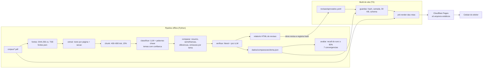

# Plano final — Comparador de Planos de Governo 2026 (MVP estático)

> Data: **sáb 17/10/2026** · 2º turno: **dom 25/10/2026** · janela: **8 dias**
> Este é o único plano do projeto. Os planos anteriores (`plan.md` da feature, `roadmap.md`
> e as duas tarefas em `.tasks/`) foram removidos em 17/10/2026; tudo que valia deles está
> aqui. A única outra fonte é a especificação `prompt-rag-planos-de-governo-2026.md`.
> Não há alternativas listadas aqui. Cada linha é a decisão.

## 1. O que vai ao ar

Um site estático, sem backend e sem LLM em tempo de execução, em que o eleitor abre no celular,
toca num tema e vê, com a mesma estrutura para os dois candidatos, o que cada plano de governo
registrado no TSE diz, onde convergem, onde divergem e o que um deles não trata. Todo ponto traz
o trecho literal, o arquivo, a página e o botão "Ver no PDF", que abre a cópia do PDF no próprio
domínio na página citada.

**Botões da tela inicial (nesta ordem):** Semelhanças, Diferenças, Programas sociais, Segurança
pública, Saúde, Tecnologia e IA, Educação, Meio ambiente, Custo de vida, Agronegócio.

**Páginas de apoio:** `/metodologia`, `/sobre`, `404`.

**Fora deste plano:** pergunta livre `/ask` e tudo que a acompanha (FAQ, cache semântico,
embeddings, cadeia de provedores, Cloud Run); aba "Na imprensa" e as camadas `declaracao` e
`imprensa`; modo "Leitura fácil"; OCR; fotos de candidatos; teste de carga; os 14 temas além dos
8 acima. Nada disso entra antes de 25/10.

## 2. Decisões fechadas

| # | Decisão | Forma final |
|---|---|---|
| 1 | Stack | Pipeline offline em **Python 3.11 + PyMuPDF**. Site em **TypeScript, Vite + React**, pré-renderizado por rota com um script próprio (`react-dom/server`), hidratação só dos controles. Hospedagem em **Cloudflare Pages**. Repositório Git único, no GitHub, com GitHub Actions. |
| 2 | Contrato `Comparação` | Um JSON por tema em `dados/comparacoes/<theme_id>.json`, no formato da §4. É o único ponto de contato entre pipeline e site; os dois validam o mesmo JSON Schema. |
| 3 | Contrato `Citação` | `{ arquivo, pagina (int ≥ 1), trecho (literal, ≤ 280 caracteres) }`. Aponta sempre para arquivo + página, nunca para id de chunk. |
| 4 | Ids dos candidatos | `flavio-bolsonaro` e `lula`. |
| 5 | URLs públicas | `/`, `/tema/<theme_id>`, `/semelhancas`, `/diferencas`, `/metodologia`, `/sobre`, `/pdf/visualizador.html?arquivo=<nome>&pagina=<n>`. `theme_id` é slug ASCII minúsculo com hífen e não muda depois de publicado. |
| 6 | `themes.yaml` | Por item: `id`, `rotulo`, `icone`, `descricao`, `palavras_chave`, `macrotema_tse` (string ou `null`). Os 8 temas do MVP, na ordem da §1. As `palavras_chave` saem do índice temático do plano de Flávio (págs. 5–7) e das 13 diretrizes do plano de Lula (pág. 3). |
| 7 | Portão de publicação | `revisao/aprovados.yaml`: mapa `theme_id: sha256`. O build do site **só inclui** temas cujo JSON tem hash igual ao registrado; um JSON presente sem hash, ou com hash divergente, **falha o build** e nomeia o tema. Nada regerado vai ao ar sem nova aprovação. |
| 8 | Recorte do MVP | 8 temas. Se em D4 algum tema não estiver aprovado, ele fica fora da grade e o site publica com os aprovados. Não há recorte menor planejado. |
| 9 | Chunking | 400–800 tokens, sobreposição de **15%**, nunca cruza fronteira de `secao`; seção com menos de 400 tokens vira um chunk só. |
| 10 | LLM da pré-computação | **Gemini Flash (free tier)**, modelo padrão `gemini-3.8-flash` (o `gemini-2.5-flash` deixou de atender contas novas em out/2026), chamado só offline. O prompt de resumo marca `[página N]` onde cada página começa dentro do chunk; se o modelo citar a página errada de um trecho literal que está em uma só página da faixa enviada, a geração corrige o número e o relatório de revisão lista a troca. Orquestração por **LangGraph** (decidido pelo dono em 18/10): grafos `comparar`, `juiz` e `classificar` em `grafos.py`, com fan-out paralelo e `RetryPolicy` (429/500/503 e rede, 5 tentativas) por nó; modelo por langchain-google-genai; **cache em disco próprio por hash do prompt**, que guarda só o texto da resposta. Versões fixadas em `docker/pipeline.requirements.txt`. Regerar um tema não gasta cota com o que já passou. |
| 11 | "Ver no PDF" | **PDF.js (`pdfjs-dist`) hospedado no próprio domínio** em `/pdf/visualizador.html`, carregado só nessa rota, abrindo `/pdf/<arquivo>.pdf` na página citada. O PDF servido é o mesmo arquivo cujo SHA-256 está em `fontes.json`. |
| 12 | Ordem dos candidatos | Sorteada 50/50 por um script inline no `<head>` que grava `data-ordem="ab"` ou `"ba"` no `<html>` antes da primeira pintura; o CSS inverte colunas e abas por esse atributo. Vale em todas as telas até recarregar. O botão "Trocar ordem dos candidatos" inverte o atributo. Não vai no link e não é guardada. |
| 13 | Celular | Duas **abas**, uma por candidato, abaixo de 768 px; duas colunas de mesma largura a partir de 768 px. |
| 14 | Textos fixos | Aviso em toda tela: "Resumos gerados por IA a partir dos planos de governo registrados no TSE. Podem conter erros — o PDF original é a fonte definitiva." Candidato sem bullet: "Não encontrado no plano de governo registrado no TSE". Visão transversal vazia: "Nenhum ponto encontrado nos temas publicados". Rodapé: "Documentos coletados do TSE em DD/MM/AAAA". |
| 15 | Prévia do link | Título = rótulo do tema; descrição = "Compare o que cada plano de governo propõe, com a página do PDF oficial"; sem imagem. |
| 16 | Lacunas apontadas pela imprensa (§11.2 da fonte) | Não aparecem. As omissões vêm só da comparação entre os dois planos. |
| 17 | Conteúdo fora de tema e repetição | Conteúdo que não cai em nenhum dos 8 temas fica invisível. Um mesmo ponto pode aparecer em mais de um tema; nada é deduplicado. |
| 18 | Contagem de uso | Analytics do lado do servidor da zona Cloudflare, por caminho. Nenhum beacon, cookie ou script de terceiro. |
| 19 | Estados de tela | Sem estado de carregamento (tudo pré-renderizado). Rota inexistente responde `404` com link para `/`. |
| 20 | Numeração dos critérios | A da §7 deste documento (AC 1–37) é a única. Qualquer referência a critério, inclusive na §11, usa essa numeração. |
| 21 | Revisão humana | O **dono do projeto** revisa o relatório HTML de cada tema, confere as páginas do conjunto-ouro e registra os hashes em `revisao/aprovados.yaml`. Ele é também o responsável identificado em `/sobre`. |
| 22 | Cores e identidade | Um único conjunto de tokens neutros (cinzas e um acento azul-petróleo escuro, longe de vermelho, azul-royal e verde-amarelo). Nenhum token, ícone ou estilo por candidato. Fontes do sistema; ícones SVG inline. |

## 3. Arquitetura



Ninguém chama backend ou LLM a partir do navegador. O único acoplamento entre os dois lados é o
JSON de `Comparação`, congelado no D0 com fixtures, para que o site seja construído antes de
existir qualquer saída de LLM.

### Estrutura do repositório

```
Rag_planos_presidencia/
├── corpus/                         # os dois PDFs, imutáveis
├── contrato/                       # fonte única da verdade entre pipeline e site
│   ├── comparacao.schema.json
│   ├── citacao.schema.json
│   ├── themes.schema.json
│   └── fixtures/<theme_id>.json    # 1 Comparação válida por tema, escrita à mão
├── pipeline/                       # Python 3.11
│   ├── pyproject.toml
│   ├── rag_planos/
│   │   ├── fontes.py               # SHA-256 local vs. TSE, fontes.json
│   │   ├── extrair.py              # PyMuPDF: texto por página, secao por fonte/negrito
│   │   ├── chunk.py
│   │   ├── classificar.py
│   │   ├── comparar.py
│   │   ├── literal.py              # normalizar() + trecho_na_pagina()  (único módulo)
│   │   ├── verificar.py            # literal + juiz LLM, motivos de descarte
│   │   ├── relatorio.py            # HTML de revisão
│   │   ├── avaliar.py              # recall do ouro + convergências
│   │   ├── llm.py                  # Gemini Flash (langchain-google-genai), cache em disco, deve_repetir
│   │   ├── grafos.py               # LangGraph: comparar, juiz, classificar; RetryPolicy por nó
│   │   └── prompts/                # classificar.md, resumo.md, comparar.md, juiz.md
│   └── tests/
├── dados/
│   ├── themes.yaml
│   ├── fontes.json
│   ├── chunks/                     # gerado; não publicado
│   ├── comparacoes/<theme_id>.json # publicados pelo site
│   ├── relatorios/                 # HTML de revisão; não publicado
│   └── ouro/conjunto-ouro.yaml
├── revisao/aprovados.yaml
├── web/                            # Vite + React + TS
│   ├── src/                        # rotas, componentes, tokens
│   ├── scripts/guardas.ts          # hash, camada, 30 KB, schema → falha o build
│   ├── scripts/prerender.ts
│   └── public/pdf/                 # cópias dos PDFs + visualizador PDF.js
├── .github/workflows/ci.yml
└── .specs/plano-final.md           # este documento
```

## 4. Contrato de dados

**`Comparação`** (`dados/comparacoes/<theme_id>.json`, ≤ 30 KB):

```json
{
  "theme_id": "saude",
  "gerado_em": "2026-10-19T14:00:00-03:00",
  "fontes": [{ "arquivo": "...pdf", "candidato": "lula", "sha256": "...", "coletado_em": "2026-10-17" }],
  "candidatos": {
    "flavio-bolsonaro": { "nao_encontrado": false, "resumo": [{ "texto": "...", "camada": "plano", "citacoes": [Citação] }] },
    "lula":             { "nao_encontrado": false, "resumo": [ ... ] }
  },
  "semelhancas": [{ "texto": "...", "camada": "plano", "citacoes": { "flavio-bolsonaro": [Citação], "lula": [Citação] } }],
  "diferencas":  [ mesmo formato de semelhancas ],
  "omissoes":    [{ "tratado_por": "lula", "texto": "...", "camada": "plano", "citacoes": [Citação] }]
}
```

**`Citação`:** `{ "arquivo": "plano-de-governo_flavio.pdf", "pagina": 26, "trecho": "≤ 280 caracteres, literal" }`.

**`Chunk`** (só no pipeline): `candidato`, `partido`, `arquivo`, `pagina`, `secao`, `texto`,
`temas: [{theme_id, confianca}]`.

**`fontes.json`:** lista de `{arquivo, candidato, partido, sha256, coletado_em, url_tse}`.

**`revisao/aprovados.yaml`:** `saude: "<sha256 do JSON aprovado>"`, um por tema.

**`dados/ouro/conjunto-ouro.yaml`:** itens `{theme_id, candidato, descricao, pagina}`, ≥ 30,
cada página conferida no PDF.

Regras invariáveis: todo bullet de resumo tem ≥ 1 citação; todo item de `semelhancas` e
`diferencas` tem ≥ 1 citação de cada candidato; todo item de `omissoes` tem ≥ 1 citação de quem
trata do tema; toda citação vem do PDF do candidato da chave; todo item tem `camada: "plano"`.

## 5. Pipeline

Comandos do operador (todos idempotentes; a saída de LLM fica em cache por hash do prompt):

| Comando | Faz | Falha quando |
|---|---|---|
| `make fontes` | baixa os PDFs da página do TSE (2º turno), compara SHA-256 com `corpus/`, grava `fontes.json` | hash diverge (sai ≠ 0 e nomeia o arquivo) |
| `make ingest` | extrai texto por página com `secao`, corta chunks, classifica nos temas | chunk sem `pagina`, chunk fora de 400–800 tokens sem ser seção curta |
| `make comparar TEMA=saude` | gera a `Comparação` do tema | — |
| `make verificar TEMA=saude` | checagem literal e juiz LLM; grava o JSON só com o que passou e o relatório HTML com os descartes (`trecho_nao_encontrado`, `nao_sustentado` + justificativa) | — |
| `make aprovar TEMA=saude` | registra o SHA-256 do JSON em `aprovados.yaml` (executado pelo dono depois de ler o relatório) | o JSON mudou depois do relatório |
| `make avaliar` | recall do ouro por tema e candidato; 7 convergências em Semelhanças | fração < 90% ou convergência faltando |

**Checagem literal (um módulo só):** normaliza os dois textos (espaços e quebras viram um
espaço; hífen de fim de linha removido) e exige que o `trecho` ocorra na página citada.

**Prompts (em `pipeline/rag_planos/prompts/`, versionados):**

1. `classificar.md`: recebe um chunk e a lista de temas; devolve `[{theme_id, confianca}]`.
   Palavras-chave de `themes.yaml` entram como sinal adicional, somado à saída do modelo.
2. `resumo.md`: por candidato e tema, recebe só os chunks daquele candidato; devolve bullets
   objetivos, cada um com `trecho` copiado literalmente e `pagina`. Regras: nenhum adjetivo
   valorativo, nenhuma informação fora dos trechos, "não encontrado" quando não houver base.
3. `comparar.md`: recebe os dois resumos verificados; devolve `semelhancas`, `diferencas` e
   `omissoes`, cada item citando os dois lados (ou o lado que trata, nas omissões). Mesmas regras.
4. `juiz.md`: recebe um bullet e seus trechos; devolve `sustentado: bool` e `justificativa`.

Todo conteúdo recuperado do PDF entra nos prompts como dado, dentro de delimitadores, nunca como
instrução.

**Conjunto-ouro:** a tabela §11.3 da fonte, item a item, com a página conferida no PDF e o
`theme_id` atribuído. A linha "Economia e trabalho" fica fora (nenhum dos 8 temas a cobre). As 7
convergências de §11.2 mapeiam assim: digitalização → `tecnologia-ia`; prontuário único e filas
do SUS → `saude`; ensino integral → `educacao`; hídrica, desmatamento e conservação →
`meio-ambiente`; fertilizantes e regularização fundiária → `agronegocio`.

## 6. Site

### Telas

```
CELULAR  /                                 CELULAR  /tema/saude
┌──────────────────────────────┐           ┌──────────────────────────────┐
│ Compare os planos de governo │           │ ← Saúde                      │
│ [aviso de IA]                │           │ [aviso de IA]                │
│ ┌────────────┐┌────────────┐ │           │ [Trocar ordem] [Só sem.][Só dif.][Tudo]
│ │Semelhanças ││ Diferenças │ │           │ ┌──────────┬──────────┐      │
│ └────────────┘└────────────┘ │           │ │ Lula     │ Flávio B.│ ← abas
│ ┌─────┐┌─────┐┌─────┐┌─────┐ │           │ ├──────────┴──────────┤      │
│ │Prog.││Seg. ││Saúde││Tec. │ │           │ │ • bullet 1        ▾ │      │
│ └─────┘└─────┘└─────┘└─────┘ │           │ │   "trecho literal"  │      │
│ ┌─────┐┌─────┐┌─────┐┌─────┐ │           │ │   arquivo · pág. 26 │      │
│ │Educ.││Meio ││Custo││Agro │ │           │ │   [Ver no PDF]      │      │
│ └─────┘└─────┘└─────┘└─────┘ │           │ │ • bullet 2        ▸ │      │
│ Metodologia · Sobre          │           │ ├─────────────────────┤      │
│ Documentos coletados do TSE  │           │ │ Semelhanças (n)     │      │
│ em 17/10/2026                │           │ │ Diferenças (n)      │      │
└──────────────────────────────┘           │ │ Omissões (n)        │      │
                                           └──────────────────────────────┘
DESKTOP /tema/saude: as duas abas viram duas colunas de mesma largura; o resto é igual.
```

### Rotas e guardas de build

| Rota | Conteúdo | Guarda que falha o build |
|---|---|---|
| `/` | grade de botões (Semelhanças, Diferenças, temas aprovados na ordem de `themes.yaml`) | — |
| `/tema/<id>` | duas áreas iguais; bullets expansíveis; filtro; "Não encontrado" | hash não aprovado, `camada ≠ plano`, JSON > 30 KB, JSON fora do schema |
| `/semelhancas`, `/diferencas` | itens de todos os temas aprovados, agrupados por tema; `/diferencas` inclui as omissões, rotuladas | — |
| `/metodologia` | etapas ingestão → classificação → comparação → verificação automática → revisão humana; regra "só documentos oficiais" | — |
| `/sobre` | por plano: arquivo, SHA-256, data de coleta, link do TSE; responsável pelo site | — |
| `/pdf/visualizador.html` | PDF.js com o PDF do próprio domínio na página pedida | — |
| outras | `404` com link para `/` | — |

### CI (GitHub Actions, a cada push)

1. `pytest` do pipeline (chunking, checagem literal com hífen e quebras, schema).
2. Guardas de build (tabela acima) e validação de todas as fixtures e JSONs contra o schema.
3. Build + pré-render; bundle inicial ≤ 200 KB gzip.
4. Lighthouse mobile em `/` e `/tema/saude`: Performance ≥ 90, Acessibilidade ≥ 90, LCP < 2,0 s.
5. axe em todas as rotas: zero `serious`/`critical`.
6. Teste de rede com Playwright: ao abrir cada rota e tocar em cada controle, só requisições ao
   próprio domínio; nenhum `Set-Cookie`; nenhum script externo.
7. Deploy de preview no Cloudflare Pages; produção só a partir da branch `main` com tag.

Cabeçalhos em `_headers` do Pages: `Content-Security-Policy: default-src 'self'`,
`X-Content-Type-Options: nosniff`, `Referrer-Policy: no-referrer`, cache longo para arquivos com
hash no nome.

## 7. Critérios de aceite (37) e provas

Cada critério vira uma prova no CI ou um teste manual registrado. As palavras-chave EARS ficam em
inglês porque o validador as procura.

### S1: Ingestão rastreável até a página

1. WHEN o pipeline roda sobre os dois PDFs THEN o sistema SHALL gravar todo chunk com `candidato`, `partido`, `arquivo`, `pagina` (inteiro ≥ 1, igual ao número impresso na página), `secao` (título da diretriz ou eixo) e `temas` (lista de `{theme_id, confianca}` com `confianca` entre 0 e 1), e nenhum chunk sem `pagina`
2. WHEN o pipeline roda THEN o sistema SHALL gravar, para cada PDF, o SHA-256 e a data de coleta, e o rodapé de toda página do site SHALL exibir "Documentos coletados do TSE em DD/MM/AAAA" com essa data
3. IF o SHA-256 do PDF baixado da página do TSE (2º turno) for diferente do SHA-256 do arquivo usado na ingestão THEN o pipeline SHALL terminar com código de saída ≠ 0 e informar qual arquivo diverge
4. WHEN o pipeline corta os chunks THEN o sistema SHALL produzir chunks de 400 a 800 tokens, com sobreposição de 15%, sem atravessar a fronteira entre duas `secao`; uma seção inteira com menos de 400 tokens vira um chunk só

### S2: Comparação por tema citada, verificada e aprovada

5. WHEN a pré-computação roda para um tema de `themes.yaml` THEN o sistema SHALL gerar `comparacoes/<theme_id>.json` no formato da §4, com ≥ 1 citação em cada bullet de resumo, ≥ 1 citação de cada candidato em cada item de `semelhancas` e `diferencas`, e ≥ 1 citação do candidato que trata do tema em cada item de `omissoes`
6. The sistema SHALL publicar somente `trecho` que aparece literalmente no texto da `pagina` citada do `arquivo` citado, depois de normalizar os dois textos (espaços e quebras de linha viram um espaço; hífen de fim de linha é removido)
7. IF o trecho de um item não for encontrado na página citada THEN o sistema SHALL deixar o item fora do JSON e listá-lo no relatório de revisão com o motivo `trecho_nao_encontrado`
8. IF a verificação por LLM julgar que um bullet não é sustentado pelos trechos que cita THEN o sistema SHALL deixar o bullet fora do JSON e listá-lo no relatório com o motivo `nao_sustentado` e a justificativa do verificador
9. IF um candidato terminar um tema sem nenhum bullet verificado THEN o sistema SHALL gravar `nao_encontrado: true` para ele, e a tela do tema SHALL mostrar na área dele exatamente "Não encontrado no plano de governo registrado no TSE"
10. IF algum item de qualquer JSON tiver `camada` diferente de `"plano"` THEN o build do site SHALL falhar
11. IF algum `comparacoes/<theme_id>.json` passar de 30 KB descomprimido THEN o build do site SHALL falhar
12. WHEN a pré-computação termina THEN o sistema SHALL gerar um relatório HTML que mostra, por tema, cada item com seus trechos e o link para a página do PDF, todos os itens descartados com o motivo, e a contagem de citações por candidato
13. IF o SHA-256 de um `comparacoes/<theme_id>.json` não estiver registrado para aquele `theme_id` em `revisao/aprovados.yaml` THEN o build do site SHALL falhar e informar o tema
14. WHEN a avaliação roda sobre o conjunto-ouro (≥ 30 itens com `theme_id`, candidato e página conferidos no PDF) THEN o sistema SHALL reportar, por tema e por candidato, a fração de itens do ouro cuja página está entre as citadas, e SHALL sair com código ≠ 0 se alguma fração ficar abaixo de 90%, listando os itens que faltaram
15. WHEN a avaliação roda THEN o sistema SHALL encontrar na visão Semelhanças um item com citação dos dois planos para cada uma das 7 convergências (digitalização dos serviços públicos; prontuário eletrônico único; redução das filas do SUS; ensino integral; infraestrutura hídrica, desmatamento e instrumentos econômicos de conservação; fertilizantes importados; regularização fundiária), e SHALL sair com código ≠ 0 se faltar alguma

### S3: Navegar por tema no celular

16. WHEN a pessoa abre `/` THEN o site SHALL mostrar uma grade de botões com Semelhanças e Diferenças primeiro, em destaque, seguidos dos temas aprovados na ordem de `themes.yaml`, cada um com ícone SVG inline e rótulo
17. WHEN a pessoa toca num tema THEN o site SHALL abrir `/tema/<theme_id>` com os dois candidatos em duas colunas de mesma largura em telas ≥ 768 px, e em duas abas, uma por candidato, em telas < 768 px
18. WHEN a pessoa expande um bullet THEN o site SHALL mostrar o trecho literal, o nome do arquivo, o número da página e o botão "Ver no PDF"
19. WHEN a pessoa toca "Ver no PDF" no Chrome Android, no Safari iOS ou num navegador de desktop THEN o site SHALL abrir o visualizador do próprio domínio com a cópia do PDF cujo SHA-256 está registrado no AC 2, na página citada
20. WHEN o site carrega pela primeira vez THEN o site SHALL sortear a ordem dos candidatos com probabilidade 50/50 e mantê-la em todas as telas até a página ser recarregada
21. WHEN a pessoa toca "Trocar ordem dos candidatos" THEN o site SHALL inverter a ordem em todas as telas
22. WHEN a pessoa escolhe "Só semelhanças" ou "Só diferenças" dentro de um tema THEN o site SHALL mostrar só os itens dessa lista, e "Mostrar tudo" SHALL voltar a exibir todos
23. WHEN a pessoa abre `/semelhancas` ou `/diferencas` THEN o site SHALL mostrar os itens de todos os temas publicados, agrupados por tema na ordem de `themes.yaml`, com as mesmas citações dos JSONs, e `/diferencas` SHALL listar também as omissões, identificadas como tais
24. IF a visão transversal não tiver nenhum item THEN o site SHALL mostrar "Nenhum ponto encontrado nos temas publicados"
25. WHEN alguém abre direto um link `/tema/<theme_id>` THEN o site SHALL mostrar a tela daquele tema sem passar pela inicial
26. IF alguém abre `/tema/<theme_id>` com um tema inexistente, ou qualquer outra rota desconhecida, THEN o site SHALL responder `404` com um link para `/`
27. The site SHALL gerar, ao abrir qualquer rota e tocar em qualquer controle, apenas requisições a arquivos estáticos do próprio domínio, sem nenhuma chamada a backend ou a LLM

### S4: Transparência e neutralidade visíveis

28. The site SHALL mostrar em toda tela o aviso "Resumos gerados por IA a partir dos planos de governo registrados no TSE. Podem conter erros — o PDF original é a fonte definitiva."
29. WHEN a pessoa abre `/sobre` THEN o site SHALL mostrar, para cada plano, o nome do arquivo, o SHA-256, a data de coleta e o link para a página do TSE, e o responsável pelo site
30. WHEN a pessoa abre `/metodologia` THEN o site SHALL mostrar as etapas ingestão → classificação → comparação → verificação automática → revisão humana e a regra "só documentos oficiais"
31. The site SHALL exibir os dois candidatos com o mesmo componente e os mesmos tokens de cor, sem nenhuma cor, ícone ou estilo atribuído a um candidato específico
32. The site SHALL responder sem nenhum cabeçalho `Set-Cookie` e sem carregar script de outro domínio

### S5: Rápido e acessível no 4G

33. The site SHALL ter bundle JavaScript inicial ≤ 200 KB em gzip
34. WHEN o Lighthouse roda no perfil mobile padrão sobre `/` e sobre `/tema/<theme_id>` THEN cada execução SHALL dar Performance ≥ 90, Acessibilidade ≥ 90 e LCP < 2,0 s
35. The site SHALL ser operável só pelo teclado em toda tela, com foco visível
36. WHEN o axe roda sobre cada rota THEN o resultado SHALL ter zero violações `serious` ou `critical`
37. WHILE o zoom está em 200% numa largura de 320 px o site SHALL não ter rolagem horizontal

### Testes independentes por fatia

| Fatia | Teste independente |
|---|---|
| S1 Ingestão | 10 chunks sorteados conferem com a página do PDF |
| S2 Comparação | alterar um `trecho` à mão → aparece como `trecho_nao_encontrado`; build sem aprovação falha e nomeia o tema |
| S3 Navegação | no celular: `/` → Saúde → expandir bullet → "Ver no PDF" abre a página certa (Chrome Android, Safari iOS, desktop) |
| S4 Transparência | DevTools em cada rota: aviso presente, zero cookies, zero scripts externos |
| S5 Desempenho e acessibilidade | Lighthouse e axe no CI sobre `/` e um tema |

Mais os números do `make avaliar`: recall ≥ 90% por tema e por candidato e 7/7 convergências.

## 8. Cronograma

Uma pessoa com agente de código, em duas trilhas intercaladas (pipeline e site). A revisão humana
dos temas é o caminho crítico, e por isso começa em D3 e não em D4.

| Dia | Data | Trilha pipeline | Trilha site | Marco do dia |
|---|---|---|---|---|
| D0 | sáb 17/10 | `git init` + GitHub; `make fontes` contra o TSE (troca o corpus se o hash divergir); `themes.yaml` dos 8 temas | `contrato/` com schemas e 8 fixtures; tokens e layout | Contrato congelado, corpus validado, as 3 entradas da §9 pedidas ao dono |
| D1 | dom 18/10 | extrair, chunk, classificar; adaptador LLM com cache; `literal.py` com testes | `/`, `/tema` sobre fixtures, `/sobre`, `/metodologia`, 404; visualizador PDF.js | Site navegável em preview com dados fictícios; "Ver no PDF" testado em Android e iOS |
| D2 | seg 19/10 | `comparar` + `verificar` + relatório para `saude` | guardas de build; CI completo; ordem sorteada; filtro | **`/tema/saude` em preview com JSON real, verificado e aprovado** |
| D3 | ter 20/10 | gerar e verificar os outros 7 temas; conjunto-ouro conferido no PDF | `/semelhancas`, `/diferencas`; ajustes de a11y e desempenho | Dono começa a revisar tema a tema; prazo das entradas da §9 |
| D4 | qua 21/10 | `make avaliar`: recall e convergências; correções nos prompts se faltar algo | correções de revisão | **8 temas aprovados, recall ≥ 90%, 7/7, CI verde** |
| D5 | qui 22/10 | — | produção no domínio final | Publicado (condicionado à §9, item 1) |
| D6 | sex 23/10 | correção de erro factual de citação, pelo mesmo portão | idem | Conteúdo congelado |
| D7–D8 | sáb 24 – dom 25/10 | nada é regerado | nada muda | Conduta no dia da eleição segue o parecer da §9 |

## 9. Entradas que só o dono fornece

Não são opções: são dados que o plano precisa e que o código não decide. Prazo: **ter 20/10 (D3)**.

| # | Entrada | Enquanto não vier |
|---|---|---|
| 1 | Parecer sobre a Res. TSE 23.610/2019 (art. 9-B, rótulo de IA) e a Lei 9.504/97 (art. 39, §5º, dia da eleição), e o nome do responsável para `/sobre`. Premissa de trabalho do plano: conteúdo informativo, não partidário, com rótulo de IA em toda tela. | o site fica na URL de preview do Cloudflare; `/sobre` sem responsável |
| 2 | Confirmação de que o próprio dono faz a revisão (decisão 21) ou o nome de quem faz | nenhum tema real é aprovado; o portão passa só com fixtures |
| 3 | Conta Cloudflare e domínio | deploy só em preview |

## 10. Riscos e a mitigação já decidida

| Risco | Mitigação |
|---|---|
| Revisão humana de 8 temas em 2 dias | revisão começa em D3 com os primeiros JSONs prontos; relatório HTML mostra cada item com link para a página; o build publica com o que estiver aprovado em D4 |
| PDFs locais (ago/2026) não serem a versão do 2º turno | `make fontes` em D0, antes de qualquer chunk; corpus trocado no mesmo dia se o hash divergir |
| `#page=N` do PDF cru não funcionar em Safari iOS e Chrome Android | decisão 11: visualizador PDF.js no próprio domínio; testado em D1 nos três navegadores |
| Cota e qualidade do Gemini Flash em português | cache em disco por prompt; prompts pedem trecho literal, e a checagem literal descarta o que o modelo inventar |
| Subseções curtas no plano de Flávio desequilibrarem o número de citações | relatório mostra a contagem de citações por candidato por tema; o dono vê o desequilíbrio antes de aprovar |
| Build quebrar por tema regerado depois de aprovado | é o comportamento desejado: hash divergente falha e nomeia o tema; o dono reaprova ou reverte |

## 11. Depois de 25/10: pergunta livre `/ask`

Única feature seguinte. Não vai ao ar antes do 2º turno e depende do MVP pronto. O que já está
decidido para ela fica registrado aqui, para não se perder.

**Reusa do MVP:** os chunks, `literal.py` (AC 6), o componente de bullet citado, a ordem dos
candidatos (AC 20 e 21), o texto "Não encontrado" (AC 9) e o portão de hash (AC 13).

**Decisões:**

| Decisão | Forma final |
|---|---|
| Backend | Python FastAPI num container do Cloud Run com `min-instances=0`; índice híbrido BM25 + vetorial e modelo de embeddings embutidos na imagem |
| Contrato | `POST /ask` recebe `{ pergunta }`; responde `{ origem: gerado \| cache \| extrativo, camada: "plano", recusada?: bool, motivo?: opiniao \| previsao \| ataque \| fora_dos_planos, candidatos: { "<candidato_id>": { nao_encontrado, resumo: [{texto, citacoes: [Citação]}] } } }`; erro `{ erro: "<codigo>" }`. `GET /health` responde `{ status: "ok" }` |
| Limite de taxa | 10 perguntas por hora por IP, chave `HMAC-SHA256(ip, chave_do_dia)` com TTL de 3600 s; a partir da 11ª, `429` com `Retry-After` |
| Cache | chave = `versao_indice` (SHA-256 dos dois PDFs + id do modelo de embeddings) + pergunta normalizada; cache semântico com cosseno ≥ 0,92; guardado até 30/11/2026 |
| Cadeia de LLM | Gemini Flash → Groq → OpenRouter `:free`; `429` ou 10 s sem resposta passa ao próximo; 3 falhas seguidas tiram o provedor por 5 min; todos fora → modo extrativo com os 3 trechos mais relevantes de cada plano |
| Recuperação | buscas separadas por candidato, 5 trechos de cada plano no contexto |
| Limites | pergunta ≤ 300 caracteres (`400`, `pergunta_muito_longa`); site espera 15 s e então mostra "Pergunta livre indisponível no momento — veja os temas acima" |
| Perguntas sugeridas | ~200, geradas de `themes.yaml` e do conjunto-ouro, agrupadas por tema, respondidas offline, verificadas e aprovadas pelo portão de hash, servidas como estático |
| Textos | carregando: "Buscando nos dois planos…"; recusa: "Este site só mostra o que os planos de governo registrados no TSE dizem. Ele não opina, não compara qual é melhor e não faz previsões."; `5xx`: `{ "erro": "interno" }` |
| Segurança e privacidade | CORS só da origem do site; CSP, `nosniff`, `Referrer-Policy: no-referrer`; segredos em Secret Manager; nenhum IP em claro em log ou store; nenhuma pergunta gravada com identificador |
| Avaliação | ≥ 30 perguntas com resposta e página esperadas; relatório de fidelidade, cobertura de páginas, taxa de "não encontrado" correto e equilíbrio entre candidatos; teste de injeção com ≥ 20 casos e zero vazamentos |
| Alertas | 70% e 90% de cada cota (Cloud Run, RPD de cada LLM, cache), por e-mail do dono via alerta de orçamento da nuvem |

**Entradas do dono antes de construir:** parecer jurídico para texto gerado em tempo real sem
revisão humana; aceite dos termos dos tiers gratuitos quanto ao uso das perguntas do público;
limiares de aprovação da avaliação.
