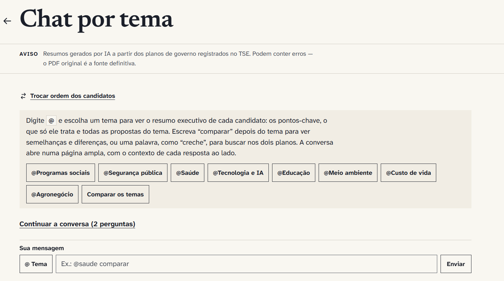

# Comparador de planos de governo 2026

Site estático que mostra, tema a tema, o que os planos de governo de Flávio Bolsonaro (PL) e de
Lula (PT), registrados no TSE para o 2º turno, propõem, onde convergem, onde divergem e o que só
um deles trata. Cada ponto traz o trecho literal, o arquivo, a página e o botão "Ver no PDF".
O plano em vigor é [.specs/plano-final.md](.specs/plano-final.md).



## Como funciona

A regra que guia o projeto: nenhuma frase vai ao ar sem o trecho literal, o arquivo e a página do
PDF oficial. A IA escreve os resumos, mas não tem a última palavra.

**O LLM só trabalha offline.** O site é estático, sem backend e sem chamada a modelo no navegador.
O pipeline em Python (PyMuPDF + LangGraph + Gemini Flash) roda antes do build:

1. confere o SHA-256 dos PDFs com os publicados pelo TSE;
2. extrai o texto por página e corta chunks de 400 a 800 tokens que nunca cruzam uma seção;
3. classifica cada chunk nos 8 temas, somando palavras-chave e a resposta do modelo;
4. resume cada candidato em separado, só com os chunks dele, e depois compara os dois resumos.

**Três camadas antes de publicar.**

- Checagem literal: o trecho citado precisa existir na página indicada, depois de normalizar
  espaços, quebras e hifenização. O que o modelo inventa é descartado.
- Juiz LLM com falha fechada: cada ponto é julgado contra os próprios trechos; na dúvida, sai.
- Revisão humana: o dono lê o relatório HTML de cada tema e registra o SHA-256 do JSON aprovado em
  `revisao/aprovados.yaml`. O build falha se algum JSON não bater com o hash, então regerar um tema
  exige nova aprovação.

**Neutralidade como requisito testável.** A ordem dos candidatos é sorteada 50/50 a cada
carregamento, e o botão "Trocar ordem dos candidatos" a inverte. A cor de cada candidato vem do
próprio PDF, com a mesma luminosidade e o mesmo croma para os dois, e só aparece em elementos não
textuais. O chat por tema monta as respostas no navegador a partir dos mesmos JSONs aprovados.

**Engenharia do site.**

- Um contrato só entre pipeline e site: o JSON Schema de `Comparação`, validado nos dois lados.
- "Ver no PDF" usa PDF.js no próprio domínio e abre a página citada também no celular.
- Sem cookie, sem beacon e sem script de terceiro; CSP por hash. Um teste e2e garante que toda
  requisição sai para a própria origem.
- CI com pytest, Vitest, Playwright (Chrome desktop, Chrome Android e Safari iOS emulados), axe,
  orçamento de JS e Lighthouse mobile.
- Tudo roda em Docker; nada é instalado na máquina.

**O que ficou de fora, e por quê.** A pergunta livre `/ask` (busca híbrida, cadeia Groq → Gemini →
OpenRouter, checagem literal) zerou os vazamentos nos 22 casos de injeção de prompt, mas ficou
abaixo das metas no conjunto-ouro: 75% de cobertura (meta de 80%) e 75% de recusa de perguntas fora
dos planos (meta de 90%). Por isso continua em prévia, fora do ar
([dados/ask/avaliacao.md](dados/ask/avaliacao.md)).

## Desenvolvimento

Em `/chat`, a pessoa digita `@tema` e vê o resumo executivo de cada candidato (até 3 pontos-chave
por plano), compara os dois planos ou busca uma palavra. As respostas são montadas no navegador com
os mesmos JSONs aprovados, sem LLM em tempo de execução ([.specs/features/chat-temas/plan.md](.specs/features/chat-temas/plan.md)).

A pergunta livre `/ask` (plano-final §11) existe só em prévia, fora do ar: serviço em `ask/` (FastAPI +
LangGraph, busca híbrida nos chunks, cadeia Groq → Gemini → OpenRouter e checagem literal) e um build do
site com "Perguntar à IA" no chat ([.specs/features/ask-previa/plan.md](.specs/features/ask-previa/plan.md)).

```
WD=ask ./dock.sh ask python -m pytest -q                               # testes do /ask
./dock.sh ask python -m ask avaliar --amostra 16 --pausa 40             # avaliação com provedor real (*)
# duas sessões ao mesmo tempo: DOCK_NOME=<nome> ./dock.sh ... usa contêiner e volume próprios
( set -a; . <(tr -d '\r' < ~/.segredos/rag-planos.env); set +a; ./ask/previa.sh )   # prévia local
```

(*) Com as chaves no ambiente, carregadas num subshell. A pausa respeita o limite de 8 mil tokens por
minuto do Groq gratuito.

Nada é instalado na máquina: todo comando roda em Docker pelo [dock.sh](dock.sh).

```
./dock.sh pipeline python -m rag_planos <comando>     # pipeline (Python 3.11 + PyMuPDF + LangGraph)
WD=web ./dock.sh web npm run <script>                 # site (Vite + React + Playwright)
```

## Estrutura

| Pasta | Conteúdo |
|---|---|
| `corpus/` | os dois PDFs, imutáveis |
| `contrato/` | JSON Schema de `Comparação`, `Citação` e `themes.yaml` |
| `pipeline/rag_planos/` | extração, chunking, classificação, comparação, verificação, relatório, avaliação, aprovação; as chamadas ao LLM são grafos LangGraph em `grafos.py` |
| `docker/pipeline.requirements.txt` | lock das 56 dependências do pipeline; mudou a imagem, rode com `REBUILD=1` |
| `dados/` | `themes.yaml`, `fontes.json`, páginas extraídas, chunks, rascunhos, vereditos do juiz, comparações, relatórios, conjunto-ouro |
| `revisao/aprovados.yaml` | portão de publicação: `theme_id: sha256` do JSON aprovado |
| `web/` | site; `scripts/build.ts` aplica as guardas e pré-renderiza as rotas |

## Fluxo de um tema

```
./dock.sh pipeline python -m rag_planos fontes --tse-dir dados/tse   # confere SHA-256 com o TSE
./dock.sh pipeline python -m rag_planos ingest
./dock.sh pipeline python -m rag_planos comparar saude               # --origem gemini com GEMINI_API_KEY (*)
./dock.sh pipeline python -m rag_planos verificar saude              # JSON + dados/relatorios/saude.html
./dock.sh pipeline python -m rag_planos aprovar saude                # só o dono, depois de ler o relatório
./dock.sh pipeline python -m rag_planos ouro && ./dock.sh pipeline python -m rag_planos avaliar
WD=web ./dock.sh web npm run build                                   # falha se algum JSON não estiver aprovado
```

(*) Com chave, as chamadas ao Gemini passam pelos grafos LangGraph de `grafos.py`. Variáveis opcionais,
repassadas pelo `dock.sh`: `GEMINI_MODELO` (padrão `gemini-3.8-flash`), `LLM_CONCORRENCIA` (padrão 4)
e `LLM_RPM`, o limite de pedidos por minuto que o AI Studio mostra para a sua conta. Cada comando
imprime chamadas, acertos de cache, falhas e tokens; o detalhe por chamada fica em
`dados/cache-llm/chamadas.jsonl`, fora do git.

## Testes

```
WD=pipeline ./dock.sh pipeline python -m pytest -q
WD=web ./dock.sh web "npx vitest run && npm run build:teste && npx playwright test && npm run orcamento && npm run lighthouse"
```

`build:teste` aprova os JSONs atuais num arquivo temporário em `/tmp` e grava em `web/dist-teste`,
que nunca volta para o disco nem é publicado.
